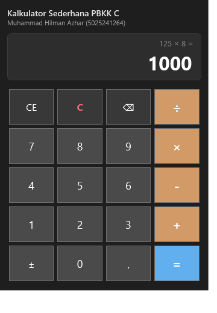

# Pertemuan 03: Aplikasi Desktop GUI - Kalkulator Sederhana

Implementasi aplikasi desktop GUI kalkulator aritmatika berbasis Windows Presentation Foundation (WPF) dan C# untuk tugas Pertemuan 03 mata kuliah Pemrograman Berbasis Kerangka Kerja (PBKK) C.

## Identitas
- **Nama:** Muhammad Hilman Azhar
- **NRP:** 5025241264
- **Kelas:** PBKK C
- **Dosen Pengampu:** Fajar Baskoro, S.Kom., M.T.
- **Laporan Notion:** [Buka Laporan di Notion](https://app.notion.com/p/Pertemuan-3-Aplikasi-Desktop-GUI-Kalkulator-Sederhana-4009c0720c5a813092a1fad8dd306dc7)

## Deskripsi Singkat
Aplikasi desktop kalkulator dengan antarmuka berbasis Grid dan tombol event handler code-behind (`MainWindow.xaml.cs`). Fitur yang diimplementasikan:
1. Operasi aritmatika dasar: Penjumlahan (`+`), Pengurangan (`-`), Perkalian (`×`), dan Pembagian (`÷`).
2. Tampilan ganda: Layar histori operasi (`txtHistory`) dan layar input/hasil utama (`txtDisplay`).
3. Penanganan error pembagian nol (`Error: Dibagi Nol`).
4. Fitur pendukung: Clear (`C`), Clear Entry (`CE`), Hapus digit terakhir (`⌫`), Negasi (`±`), dan tanda desimal (`.`).

## Struktur Berkas
- `MainWindow.xaml`: Tata letak antarmuka visual kalkulator menggunakan kontrol WPF (`Grid`, `Border`, `TextBox`, `Button`).
- `MainWindow.xaml.cs`: Logika perhitungan aritmatika dan event handler klik tombol.
- `Pertemuan-03-Desktop-Calculator.csproj`: Berkas konfigurasi proyek WPF .NET 10.0.
- `screenshots/calculator_gui.png`: Tangkapan layar antarmuka aplikasi kalkulator saat dijalankan.

## Cara Menjalankan
Pastikan .NET SDK telah terinstal di Windows.

```bash
dotnet run
```

## Hasil Eksekusi
Tampilan jendela aplikasi kalkulator desktop WPF saat dijalankan:


